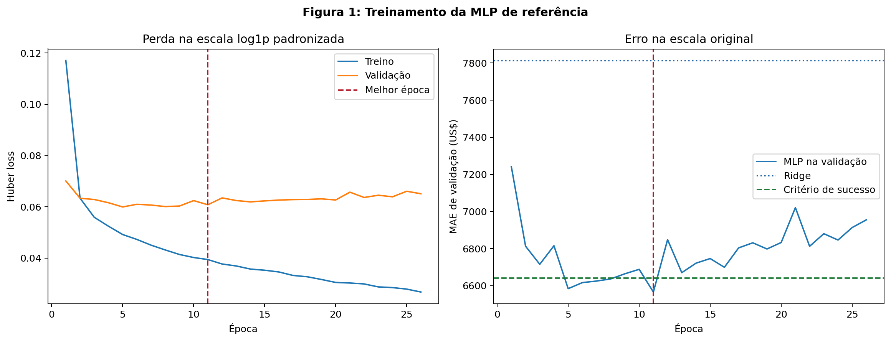
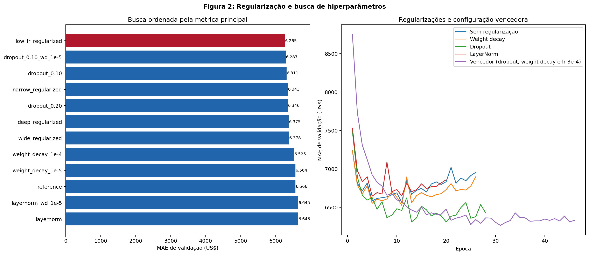
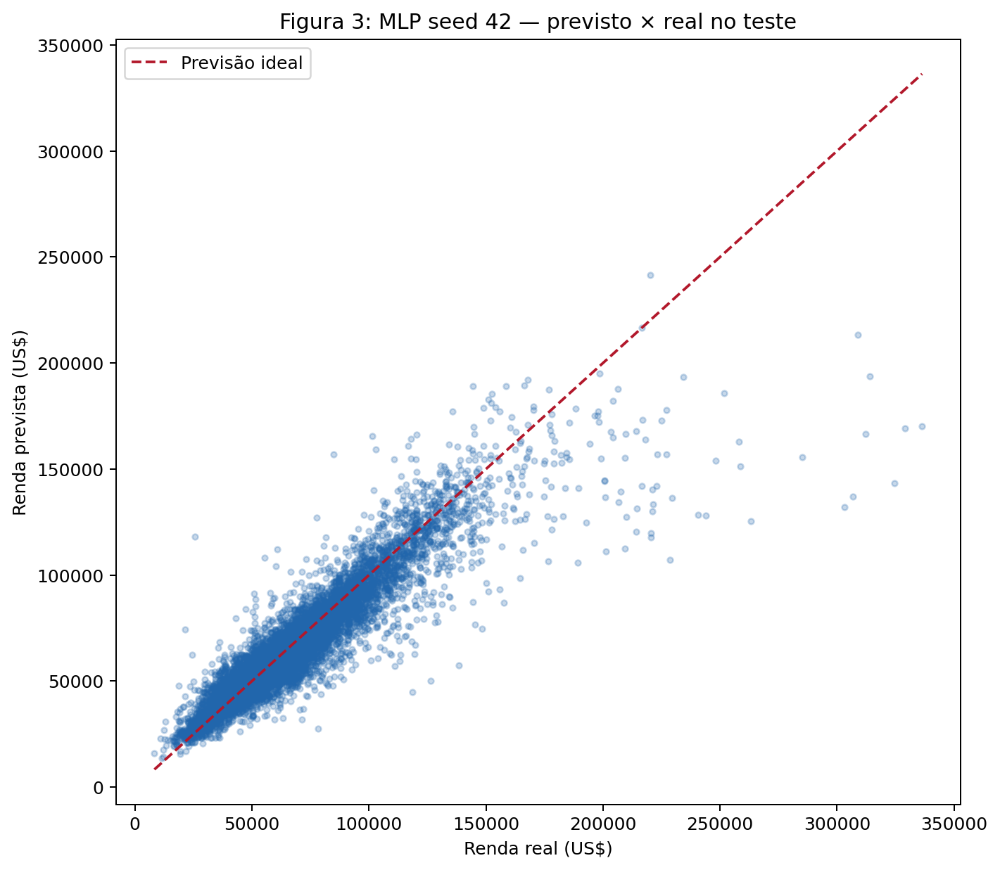
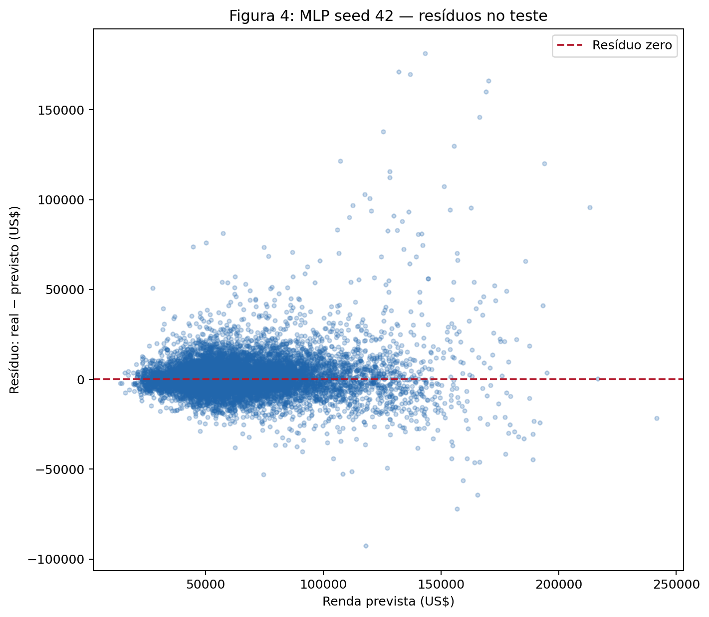
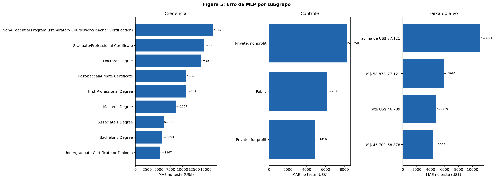
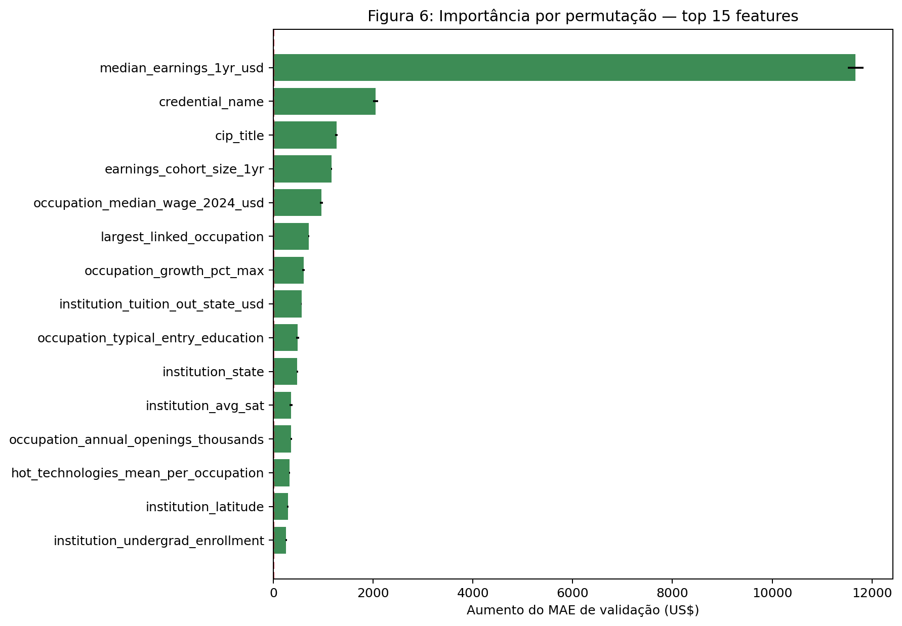

# Projeto: Regressão com redes neurais

## 0. Ponto de partida

O objetivo permanece o definido na EDA: prever `median_earnings_4yr_usd`, a
renda anual mediana quatro anos depois da conclusão. O pré-processador é
importado diretamente de [`pipeline.py`](../eda/code/pipeline.py) e mantém as
estratégias justificadas na primeira entrega: clipping por IQR, imputação,
indicadores de ausência, padronização e one-hot encoding com agrupamento de
categorias raras.

A métrica principal, registrada antes de qualquer treinamento, é o **MAE em
dólares**. A rede será considerada bem-sucedida se alcançar MAE pelo menos
**15% menor que o melhor baseline obrigatório** (`DummyRegressor` ou Ridge),
isto é, `MAE_MLP ≤ 0,85 × MAE_melhor_baseline`. RMSE e R² serão métricas
secundárias.

O split externo reproduz exatamente a EDA com `GroupShuffleSplit`, agrupado por
`opeid6`, `test_size=0.20` e semente 42. A validação sai apenas do treino da
EDA, novamente agrupada por instituição, com proporção 20% e semente 42:

| Conjunto | Programas | Instituições |
|---|---:|---:|
| Treino | 36.565 | 2.969 |
| Validação | 9.758 | 743 |
| Teste bloqueado | 11.740 | 928 |

Há zero instituições compartilhadas entre quaisquer dois conjuntos. O
pré-processador é ajustado somente nas 36.565 linhas do treino interno e
transforma treino e validação em matrizes CSR `float32` com 420 features e
zero `NaN`. O teste não é transformado, inspecionado por estatísticas do alvo
nem usado para métricas nesta etapa. Identidades, hashes e invariantes estão no
[`split_manifest.json`](split_manifest.json) e podem ser conferidos com:

```bash
python -m docs.projects.regression.code.data --check
```

## 1. Baselines

Os dois baselines obrigatórios usam exatamente as mesmas 420 features geradas
pelo pipeline ajustado no treino interno. O teste continua bloqueado: todos os
números desta seção são da **validação**.

O baseline trivial é `DummyRegressor(strategy="mean")`: ele prevê para todo
programa a renda média observada no treino. Portanto, mede quanto se ganha
apenas por sair de uma constante, sem usar nenhuma feature. O baseline linear
é Ridge, que combina as features por uma função linear e penaliza coeficientes
grandes. Como o pipeline já padroniza as numéricas, comparamos a grade de
`alpha` **0,001; 0,01; 0,1; 1; 10; 100; 1.000; 10.000**, declarada antes da
execução. A escolha é feita pelo menor MAE, a métrica principal.

--8<-- "docs/projects/regression/tables/baseline_validation.md"

O melhor baseline pela regra registrada foi **Ridge com `alpha=1`**, com MAE
de **US$ 7.813,89**, RMSE de **US$ 11.795,41** e R² de **0,816399**. O
`DummyRegressor` obteve MAE de **US$ 20.023,63**, então a regressão linear
reduziu o erro absoluto em aproximadamente **61,0%**. Isso indica que uma
combinação linear das features — especialmente após o tratamento das
categorias — já explica uma parcela grande da variação e será uma referência
exigente para a rede.

Ridge com `alpha=0,1` teve RMSE marginalmente menor (US$ 11.795,13), mas não é
o vencedor porque a seleção foi fixada pelo MAE antes da execução. Para cumprir
o critério de sucesso de 15%, a futura MLP deverá alcançar na validação MAE de
no máximo **US$ 6.641,81**. Nenhum desses resultados antecipa o desempenho no
teste.

## 2. A rede

A rede de referência recebe as **420 features** do mesmo pipeline usado pelos
baselines e tem arquitetura **420 → 128 → 64 → 1**. As duas camadas ocultas
usam ReLU, o que permite aprender relações não lineares; a saída tem uma única
unidade linear, adequada à regressão porque não limita artificialmente a faixa
das previsões.

As larguras 128 e 64 formam um gargalo progressivo: reduzem as 420 entradas
sem colapsar diretamente para uma representação muito estreita e mantêm a
maior parte da capacidade na primeira combinação das features numéricas e
one-hot. Elas foram escolhidas como uma referência intermediária, antes da
busca, para evitar tanto uma rede quase linear quanto uma expansão grande da
representação. O orçamento resultante também permanece próximo da escala do
dataset, em vez de introduzir centenas de milhares de parâmetros já no modelo
de controle.

Os pesos das camadas ocultas usam inicialização de Kaiming, coerente com ReLU;
a saída usa Xavier e todos os vieses começam em zero. A rede tem **62.209
parâmetros treináveis**, equivalentes a **1,70 parâmetro por linha** nas 36.565
linhas do treino interno. É capacidade suficiente para uma referência não
linear, mas grande o bastante para exigir a análise de overfitting abaixo.

Esta primeira rede é deliberadamente **sem regularização**: não usa dropout,
BatchNorm/LayerNorm nem weight decay. Ela será o controle para as comparações
do Entregável 4, e não a configuração final.

## 3. Treinamento

O alvo recebe `log1p` para reduzir a assimetria observada na EDA e depois é
padronizado pela média (**10,9913698970**) e pelo desvio
(**0,4008667477**) aprendidos somente no treino. A rede otimiza Huber loss com
`delta=1` nessa escala; todas as previsões são invertidas para dólares antes de
calcular MAE, RMSE e R².

O treinamento usa Adam porque suas taxas adaptativas são uma referência
robusta para uma entrada que mistura colunas numéricas padronizadas e muitas
dummies esparsas, sem exigir ajuste separado de momentum. O learning rate
**0,001** é o ponto de partida da rede de controle e depois entra
explicitamente na busca; a configuração final usa `3e-4` porque venceu na
validação, não por observação do teste.

O batch **256** produz cerca de 143 atualizações por época nas 36.565 linhas,
mantendo diversidade entre lotes sem tornar cada época excessivamente longa
na CPU. O máximo de **200 épocas** é apenas um teto amplo para também acomodar
configurações com learning rate menor. O número efetivo de épocas é decidido
pelo early stopping, que monitora diretamente o MAE em dólares, com paciência
15 e melhora mínima de US$ 1, guarda em memória e restaura os melhores pesos.
A execução canônica usa semente 42, CPU e operações determinísticas.



A rede aprende rapidamente nas primeiras épocas: o MAE cai de US$ 7.241,40 na
época 1 para US$ 6.584,17 na época 5. O melhor ponto pela métrica principal é a
**época 11**, com **MAE US$ 6.566,01**, **RMSE US$ 10.205,46** e **R²
0,862559**. A execução para na época **26** e restaura os pesos da época 11.

Depois da época 11, a loss de treino continua caindo, de 0,03943 para 0,02677,
enquanto a loss de validação sobe de 0,06080 para 0,06510 e o MAE oscila sem
nova melhora. Essa abertura entre as curvas é evidência de overfitting e
justifica tanto o early stopping quanto a comparação de regularização na etapa
seguinte. A menor Huber loss de validação ocorre antes do menor MAE em dólares;
isso reforça a decisão de restaurar pela métrica principal, e não pela loss
transformada.

Na validação, esta referência reduz o MAE do Ridge em **15,97%** e fica US$
**75,80** abaixo do limite preliminar de US$ 6.641,81. Isso ainda não responde
ao critério final: arquitetura e regularização serão escolhidas na validação e
o teste só será aberto na etapa 5.

## 4. Regularização e hiperparâmetros

A busca foi declarada antes da execução com **12 configurações** e manteve o
mesmo protocolo da referência: Huber, alvo em `log1p`, batch 256, no máximo
200 épocas, early stopping, CPU e semente 42. Comparamos diretamente a rede
sem regularização com dropout, weight decay e LayerNorm. A grade também variou
learning rate, largura e profundidade; todas as escolhas foram feitas somente
pelo MAE de validação.

--8<-- "docs/projects/regression/tables/hyperparameter_search.md"



Todas as 12 configurações terminaram sem falhas. Dropout foi a intervenção
isolada mais efetiva: com taxa 0,10, o MAE caiu de **US$ 6.566,01** para **US$
6.311,16**. Weight decay isolado teve efeito bem menor: `1e-4` chegou a **US$
6.525,00**, enquanto `1e-5` praticamente empatou com a referência (**US$
6.563,99**). LayerNorm não ajudou neste problema tabular e obteve **US$
6.645,81** sem weight decay, resultado pior que o controle.

A largura adicional também não trouxe ganho: a rede com 140.801 parâmetros
ficou em US$ 6.378,43. A versão estreita, com apenas 29.057 parâmetros, chegou
a US$ 6.342,91 e superou a versão larga, sinal de que aumentar capacidade não
era a principal necessidade. A rede profunda ficou entre elas, com US$
6.374,71. Esses resultados são coerentes com o overfitting observado na
referência, e não com underfitting por falta de parâmetros.

O vencedor provisório foi **`low_lr_regularized`**: arquitetura 420 → 128 → 64
→ 1, dropout 0,10, weight decay `1e-5` e learning rate `3e-4`. Ele alcançou
**MAE US$ 6.265,05**, **RMSE US$ 9.821,37** e **R² 0,872710** na época 31,
parando na época 46. Isso reduz o MAE da referência em **4,58%** e o do Ridge
em **19,82%**, ficando US$ **376,76** abaixo do critério preliminar.

As curvas mostram por que o learning rate menor foi útil: o vencedor convergiu
mais lentamente e atingiu sua melhor época depois das outras configurações.
Mesmo com dropout, após a época 31 a loss de treino caiu de 0,04761 para
0,04199, enquanto a de validação subiu de 0,05594 para 0,05697; portanto,
early stopping ainda é necessário. LayerNorm apresentou oscilações maiores e
começou a piorar cedo, com melhor MAE já na época 5. A configuração vencedora
é apenas uma recomendação desta busca; seu congelamento ocorre na próxima
etapa, ainda sem acessar o teste.

### Configuração congelada

A recomendação foi congelada em [`final_config.json`](final_config.json) antes
de qualquer avaliação no teste. Esse contrato fixa arquitetura, transformação
do alvo, loss, otimizador, learning rate, batch, regularização, early stopping
e a semente canônica **42**. A época 31 é somente a evidência da seleção: novos
treinamentos continuarão restaurando a melhor época de validação, em vez de
fixar a duração em 31 épocas.

O arquivo é derivado da primeira linha da busca e validado contra ela; uma
mudança no vencedor, nas métricas ou no protocolo faz a verificação falhar.
Ele registra explicitamente `test_accessed: false`, e o script de busca rejeita
objetos que exponham campos de teste. Para a avaliação final, a mesma
configuração foi repetida com as seeds 42, 43 e 44, sem nova seleção de
hiperparâmetros.

## 5. Avaliação no teste

A configuração foi escolhida e congelada antes desta etapa. As três MLPs, o
Ridge e o Dummy foram ajustados nas mesmas 36.565 linhas de treino; somente as
MLPs usaram a validação para early stopping. As redes foram treinadas com
seeds **42, 43 e 44** antes de carregar e transformar os mesmos 11.740
programas de teste.

Uma primeira avaliação apenas com a seed 42 havia sido produzida por engano.
Para atender à rubrica, o teste precisou ser reaberto uma segunda vez, sem
alterar configuração, pipeline ou critério após o primeiro resultado. O
artefato registra esse histórico como `test_access_count: 2` e registra que a
execução multiseed carregou o teste uma única vez.

--8<-- "docs/projects/regression/tables/final_test_metrics.md"

As seeds 42, 43 e 44 pararam, respectivamente, nas épocas **46, 42 e 51**, com
melhores pesos nas épocas **31, 27 e 36**. O resultado agregado foi **MAE US$
6.573,47 ± US$ 18,90**, **RMSE US$ 11.152,28 ± US$ 86,80** e **R² 0,846778 ±
0,002380**, usando desvio amostral. O melhor baseline continuou sendo o Ridge,
com MAE **US$ 8.035,06**. O limite de 15% era **US$ 6.829,80**; o MAE médio da
MLP ficou US$ **256,33** abaixo dele e reduziu o erro do Ridge em **18,19%**.
A diferença de **US$ 1.461,59** para o Ridge é muito maior que o desvio de US$
18,90 entre seeds, portanto o critério foi atingido de forma estável nas três
inicializações avaliadas.



Os gráficos usam a seed 42, fixada previamente como referência para a análise
por programa. O gráfico previsto × real concentra a maior parte dos programas ao redor da
diagonal, mas mostra compressão nas rendas mais altas: vários valores reais na
cauda recebem previsões menores. Isso é compatível com regressão em direção à
média e ajuda a explicar por que o RMSE permanece substancialmente maior que o
MAE.



Os resíduos se espalham mais à medida que a renda prevista cresce. Há erros
positivos grandes — subestimações — entre os programas de maior renda, embora
também existam superestimações relevantes. Esse padrão de heterocedasticidade
motiva a análise por faixa do alvo e por categoria na etapa seguinte.

As três seeds atendem ao mínimo da rubrica e permitem uma estimativa inicial
da variação entre inicializações. Ainda assim, três execuções são uma amostra
pequena e não substituem uma análise mais ampla de estabilidade.

## 6. Análise de erros

Esta etapa não reabre o teste: os erros abaixo usam a **seed 42 como referência
fixa** e são calculados a partir das previsões finais já congeladas. Para evitar faixas escolhidas depois de ver os
resultados, usamos os quartis do alvo no treino registrados na EDA: US$
46.709, US$ 58.878 e US$ 77.121. Grupos com menos de 100 programas são
marcados e não sustentam conclusões fortes isoladamente.

### Subgrupos e faixas do alvo

--8<-- "docs/projects/regression/tables/error_by_credential.md"

Os maiores MAEs por credencial aparecem em programas sem credencial (**US$
16.521,33; n=45**) e certificados de pós-graduação (**US$ 14.611,68; n=92**),
mas ambos são grupos pequenos. O resultado mais robusto é o de doutorado, com
**MAE US$ 13.941,77 em 257 programas**. Essas credenciais ocupam regiões mais
altas e heterogêneas da distribuição de renda e têm menos exemplos; a rede
tende a trazê-las em direção à média.

--8<-- "docs/projects/regression/tables/error_by_institution_control.md"

Instituições privadas sem fins lucrativos têm MAE de **US$ 8.260,52**, contra
US$ 6.167,99 nas públicas e US$ 4.868,00 nas privadas com fins lucrativos.
Como `institution_control` aparece apenas na posição 22 da importância, com
ΔMAE de US$ 175,45, essa diferença parece refletir sobretudo a composição dos
programas — mais pós-graduação e rendas altas — e não dependência direta forte
do modelo nessa categoria.

--8<-- "docs/projects/regression/tables/error_by_target_band.md"

A faixa acima de **US$ 77.121** concentra o maior erro: MAE de **US$
11.140,35** e resíduo médio positivo de **US$ 6.323,68**, isto é,
subestimação. Na faixa mais baixa o resíduo médio é negativo em US$ 3.137,83,
indicando superestimação. O sinal muda ao atravessar a distribuição e confirma
regressão em direção à média.



### Piores exemplos

--8<-- "docs/projects/regression/tables/worst_test_errors.md"

Os cinco maiores erros são subestimações de programas com renda real acima de
US$ 303 mil, mas previsões entre aproximadamente US$ 132 mil e US$ 170 mil.
Eles incluem doutorado, mestrado e certificado profissional, em instituições
públicas e privadas sem fins lucrativos. Portanto, o padrão não parece ser um
único tipo institucional: são observações extremas em uma cauda pouco
representada, comprimida pelo aprendizado no alvo em `log1p` e pela tendência
do modelo a evitar previsões extremas.

### Importância por permutação

A importância foi calculada na **validação**, com três permutações por feature
original. Cada categórica é embaralhada antes do pipeline, preservando como um
grupo todas as suas dummies; numéricas também carregam juntas seu valor e o
indicador de ausência. Valores representam quanto o MAE aumenta ao destruir a
informação da feature.



--8<-- "docs/projects/regression/tables/permutation_importance.md"

`median_earnings_1yr_usd` domina, com aumento médio de **US$ 11.670,45** no
MAE permutado. Depois vêm credencial (**US$ 2.048,90**), curso/CIP (**US$
1.267,74**), tamanho da coorte de um ano (**US$ 1.168,52**) e salário mediano
da ocupação (**US$ 965,21**). Isso confirma a EDA: renda de um ano tinha
Spearman ρ=0,887 com o alvo, enquanto curso, credencial e mercado de trabalho
traziam sinais secundários. Mensalidade out-of-state e tecnologias emergentes
também aparecem entre as quinze primeiras, coerentes com as associações da
EDA; controle institucional é bem menos importante diretamente.

### Ablação da renda de primeiro ano

--8<-- "docs/projects/regression/tables/earnings_1yr_ablation.md"

Sem `median_earnings_1yr_usd` — incluindo seu indicador de ausência — a
largura cai de 420 para 418 features e o MAE de validação sobe de **US$
6.265,05 para US$ 7.868,25**, piora de **US$ 1.603,19 (25,59%)**. A rede ainda
aprende com curso, credencial, instituição e ocupação, mas perde uma parte
substancial da precisão.

O ΔMAE da permutação é muito maior que o da ablação porque embaralhar a renda
de um ano cria combinações artificiais e quebra sua relação com várias outras
features; remover a coluna permite que o modelo se reajuste. Assim, a ablação
é a estimativa mais realista do custo de operar sem essa informação, enquanto
a permutação mede sua relevância no modelo já treinado. Nenhuma das duas deve
ser interpretada como efeito causal.

## 7. Conclusão

Dentro desta tarefa, **a MLP valeu a pena em precisão preditiva**. Seu MAE
médio de teste foi **US$ 6.573,47 ± US$ 18,90**, contra **US$ 8.035,06** do
Ridge: redução de **18,19%**, superior ao critério de 15% registrado antes do treinamento. O
ganho veio de relações não lineares entre renda anterior, curso, credencial,
instituição e ocupação que o baseline linear não capturou por completo.

Esse resultado não autoriza usar a previsão como garantia de renda individual
nem como ranking automático de cursos. A unidade do modelo é um programa e o
alvo é uma mediana de coorte; trajetórias individuais dependem de região,
experiência, setor, condições econômicas e muitas informações ausentes da
base. Uma previsão errada poderia induzir estudantes a escolher ou abandonar
um curso e levar gestores a distribuir recursos de modo inadequado. Portanto,
o modelo só deve apoiar análises agregadas, acompanhado dos dados observados,
de revisão humana e de monitoramento dos erros por subgrupo.

As limitações mais importantes são:

- somente três seeds foram avaliadas, o mínimo da rubrica, então a estimativa
  de variabilidade ainda tem baixa precisão;
- a correção multiseed exigiu reabrir o teste após a primeira avaliação de
  seed única; nenhum hiperparâmetro foi alterado depois desse primeiro acesso,
  mas o protocolo ideal de acesso único não foi cumprido historicamente;
- **74,51%** dos alvos da base original estavam suprimidos, principalmente por
  regras de privacidade ligadas ao tamanho da coorte; o domínio aprendido
  representa programas com renda divulgada e pode não generalizar para
  programas pequenos ou suprimidos;
- a rede subestima a cauda de renda e não fornece intervalo de incerteza;
- a precisão depende fortemente da renda de primeiro ano, informação que só
  existe depois da conclusão e limita usos prospectivos no momento da
  matrícula;
- a avaliação usa um único recorte temporal e não mede mudança do mercado de
  trabalho; além disso, importância e correlação são associações, não efeitos
  causais.

Com mais tempo, executaríamos mais seeds, adicionaríamos intervalos por
regressão quantílica ou ensembles, trataríamos explicitamente a cauda,
compararíamos uma versão operacional sem renda de primeiro ano e faríamos
validação temporal externa. Antes de qualquer uso real, também seriam
necessárias auditorias periódicas de calibração e erro por credencial,
controle institucional e faixa de renda.

### Resumo dos resultados

| # | Resumo | Valor |
|---:|---|---|
| 1 | Dataset, tarefa, alvo e métrica principal | College Majors 2026; regressão de `median_earnings_4yr_usd`; MAE em dólares |
| 2 | Treino · validação · teste (linhas) | 36.565 · 9.758 · 11.740 |
| 3 | Melhor baseline e sua métrica no teste | Ridge `alpha=1`; MAE US$ 8.035,06 |
| 4 | Rede escolhida: camadas × unidades, parâmetros e regularização | 420→128→64→1; 62.209 parâmetros; dropout 0,10 e weight decay `1e-5` |
| 5 | Otimizador, learning rate, batch e época de parada | Adam; `3e-4`; batch 256; paradas 46 · 42 · 51 nas seeds 42 · 43 · 44 |
| 6 | Métrica principal da rede no teste | MAE US$ 6.573,47 ± US$ 18,90, média ± desvio amostral de 3 seeds |
| 7 | Critério de sucesso atingido? | Sim; MAE médio 18,19% menor que o Ridge, acima dos 15% exigidos |
| 8 | Subgrupo com maior erro | Programas sem credencial; MAE US$ 16.521,33; `n=45`, grupo pequeno |
